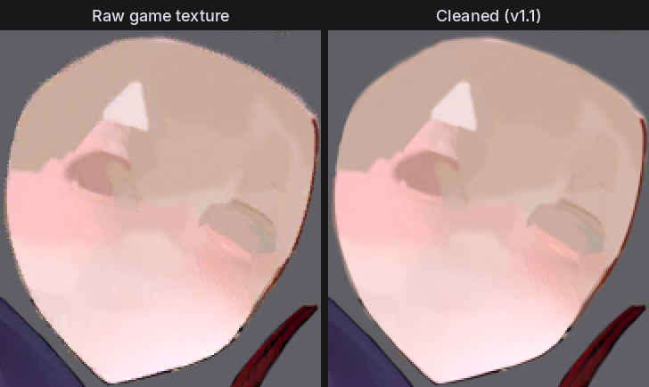
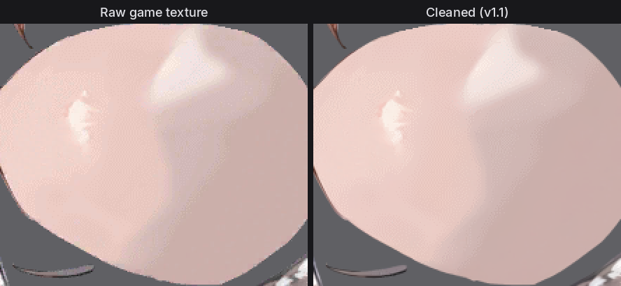
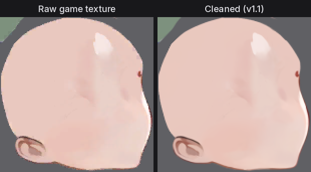

# Echocalypse Texture Cleaner

Removes ETC2 compression damage from the Spine character textures of *Echocalypse: The Scarlet Covenant*: the dotted
block noise, the grey fringes on soft edges, and most of the seam lines where skin pieces overlap.

The game ships every character texture as ETC2. This project identified the exact encoder the game's build uses, so the
models are trained on the real damage and not on an approximation of it.

| On a real game texture with a known clean original (held out from training) | PSNR | Soft edges | Seam error | SSIM |
|---|---|---|---|---|
| Raw game texture | 36.38 dB | 36.05 dB | 0.880 | 0.9112 |
| Stage 1, single pass | 42.54 dB | 42.97 dB | 0.548 | 0.9896 |
| Stage 1, 8x self-ensemble | 42.88 dB | 43.33 dB | 0.529 | 0.9908 |
| Full pipeline (default) | 43.07 dB | 43.58 dB | 0.502 | 0.9911 |

Seam error is the render error when a piece is drawn over its own skin colour, counting only line-like error, in 8-bit
levels; a clean original scores 0. Seams get much fainter. They do not all disappear: very small pieces (a mouth patch a
few blocks wide) lose their edge colour at compression time and no model can know what it was.

## Before and after

The face skin piece of three characters, cut from the texture atlas and shown at twice its size without smoothing. Left
is the game's file as shipped, right is the same file after `clean.py` with the default settings.

**Scarlett**



**Nile**



**Neville (skin)**



## What is in here

- `clean.py`: clean raw game textures into ordinary PNGs.
- `evaluate.py`: score the cleaner on a raw texture plus its clean original.
- `train_stage1.py`, `train_refiner.py`: train or fine-tune the two models on your own clean art.
- `tools/fetch_textures.py`: download raw hero textures (and the better "censor pack" versions) from the game's update CDN.
- `echoclean/`: the library the scripts use.

Not in here: any game art beyond the three small comparison crops above, and the encoder itself (Ericsson ETCPACK; its licence does not allow redistribution, so a
script downloads and builds it on your machine).

## Setup

Linux with Python 3.10 or newer. On Windows use WSL. An NVIDIA or AMD GPU is strongly recommended: a 2048x2048 texture
takes about 8 seconds on a mid-range GPU (measured on a Radeon RX 9060 XT) and many minutes on a CPU.

```bash
git clone https://github.com/oedon81/Echocalypse-Texture-Cleaner
cd Echocalypse-Texture-Cleaner
```

1. Install PyTorch for your GPU from <https://pytorch.org> (CUDA for NVIDIA, ROCm for AMD).
2. Install the rest:

```bash
pip install -r requirements.txt
```

3. Download `echoclean_stage1.pt` and `echoclean_refiner.pt` from the
   [Releases page](https://github.com/oedon81/Echocalypse-Texture-Cleaner/releases) into the `models/` folder.
4. Build the encoder library (needed for the refiner and for training). It needs `git` and a C++ compiler:

```bash
./build_etcpack.sh
```

If you have no compiler, `pip install ziglang` provides one and the script will use it. If you skip this step entirely
you can still clean with `--no-refiner`.

## Cleaning textures

The input must be the **raw** game files, exactly as the game ships them, for example
`.../res/common/knight_spine/<id>/<id>.png`. Despite the name these are not PNGs; they are ETC2 data in the game's own
wrapper. The cleaner needs the compressed blocks, so a texture that was already decoded to a real PNG will not work.

```bash
python clean.py path/to/knight_spine/600090 -o cleaned/600090 --copy-others
```

- A folder is searched recursively and the output keeps the same layout and file names.
- The output files are real PNGs with premultiplied alpha, the same as the game's textures.
- `--copy-others` also copies the `.atlas` and `.skel` files, so the output folder is a complete Spine 3.8 model.
- Re-running skips files that are already done.

| Option | Effect |
|---|---|
| `--no-ensemble` | One pass instead of eight flips/rotations, in both stages: 3.4 s instead of 8.3 s per 2048x2048 texture, about 0.3 dB lower |
| `--refiner-passes N` | How often stage 2 re-compresses and corrects (default 2). 1 takes 6.1 s and is 0.04 dB lower; 3 takes 10.6 s and is 0.02 dB higher |
| `--no-refiner` | Skip stage 2: no encoder library needed, 3.8 s, about 0.2 dB lower |
| `--fp32` | Full precision on the GPU: twice as slow, same scores as the default half precision |
| `--cpu` | Run without a GPU |

### Getting the raw files

Either copy them from your own game install, or download them:

```bash
python tools/fetch_textures.py list                       # every hero id
python tools/fetch_textures.py get 600090 700120 -o raw   # raw/<id>/...
```

### Use the censor pack when there is one

The China build has a separate "censor pack" for 316 heroes. For about 130 older heroes that pack contains the same
art encoded from the original picture, while the normal file was encoded from a dithered export. The pack is then a
much better input: about 3 to 4 dB closer to the original before any cleaning, and without the dotted texture on faces.

```bash
python tools/fetch_textures.py censor 700120 -o raw_censor
python clean.py raw_censor/700120 -o cleaned/700120 --copy-others
```

Check a pack before you rely on it:

- Some packs are byte-identical to the normal file (nothing gained), and newer heroes have no pack.
- A few are really censored (the art is changed), and some use a different atlas layout or a different export, so their
  texture only works with the pack's own `.atlas` and `.skel`.

## Checking a result

If you have a clean original of a texture (a few old game builds shipped some uncompressed), you can measure:

```bash
python evaluate.py --raw raw/600090/600090.png --clean originals/600090.png
```

The first line reports how many of the game's blocks come out byte for byte when the clean file is re-encoded. 100%
means the clean file really is what the game encoded. A low number means it is a different export of the same art,
and the scores below it are then not meaningful.

## Training

Training needs clean, uncompressed RGBA art. More and closer to the game's style is better. The scripts damage it on
the fly with the game's encoder, so the clean images are all you provide.

Fine-tune the released stage-1 model:

```bash
python train_stage1.py --name myrun \
    --data path/to/echocalypse_clean:0.4 --data path/to/other_clean_art:0.6 \
    --init models/echoclean_stage1.pt \
    --val-raw raw/600090/600090.png --val-clean originals/600090.png
```

- `--data` is a folder of PNGs (searched recursively) or a text file of image paths. `:0.4` sets how often that set is
  sampled.
- `--val-raw` / `--val-clean` is an optional real pair scored every 2,000 steps. Keep that image out of `--data`.
- Leave out `--init` to train from scratch (use about 150,000 steps).
- Results go to `runs/<name>/`: `ckpt_last.pt`, `ckpt_best.pt` and `log.txt`.

Then train the refiner on top of it:

```bash
python train_refiner.py --name myrefiner --stage1 runs/myrun/ckpt_best.pt \
    --data path/to/echocalypse_clean:0.4 --data path/to/other_clean_art:0.6 \
    --init models/echoclean_refiner.pt
```

Use your models with `python clean.py ... --stage1 runs/myrun/ckpt_best.pt --refiner runs/myrefiner/ckpt_best.pt`.

Things learned the hard way:

- **The last gains come at low learning rates.** A run that looks flat usually steps up again when the rate drops. The
  released stage 1 was finished at 5e-6 and then 2.5e-6.
- **Memory.** Each data worker keeps a few clean images in memory; lower `--pool` or `--workers` if RAM is short.
- **One training at a time** on a 16 GB machine.
- **Rebuild the encoder library if your checkout is older than v1.1** (`./build_etcpack.sh`). It used to take `rand()`
  from this machine and matched 99.3% of the game's blocks. It matches 100% now (see below). The v1.1 models were
  fine-tuned with the exact library; that was worth about 0.02 dB over the v1.0 models in the same pipeline.

## How it works

1. **The encoder.** The game's textures are made with Ericsson ETCPACK 2.74 in `fast` + `perceptual` mode, evidently on a
   Mac. The Mac matters: for blocks in T or H mode ETCPACK starts its search from `rand()`, so the result depends on the C
   library. With Apple's `rand()` (built into `native/etcpack_lib.cxx`), encoding a clean original reproduces the
   game's blocks byte for byte: 100% on the test pair, against 99.3% with Linux's `rand()`. A general-purpose ETC2
   encoder gets about 2% at soft edges, and its errors there go in the opposite direction.
2. **Stage 1** is a residual CNN (9.6M parameters) on the decoded texture plus side information read from the compressed
   blocks: each texel's position inside its 4x4 block, the alpha range its code stands for, and the block's colour mode.
   Besides plain pixel error it is trained on the texture composited over its own colour, which is where seams show.
3. **Self-ensemble.** The texture is cleaned in eight flips and rotations and the results are averaged.
4. **Stage 2, the refiner** (2.4M parameters). A clean original always re-compresses to exactly the game's blocks. The
   refiner is shown how the stage-1 output re-compresses and which blocks do not match, and corrects it. It runs twice
   (the second time on its own result, re-compressed again), each time in eight flips and rotations, and the two
   results are averaged. Nothing is rounded to 8 bits until the very end.

What did not help, in case you want to try: a much bigger model, a four times heavier seam loss, larger training
patches, and blending in a second, worse copy of the same texture. Without retraining: clamping alpha to the range its
code allows (the model already stays inside it), moving blocks until they re-compress to the game's data (worse), and
scaling the corrections up or down. A second refiner pass only pays off now that nothing is rounded between the
passes (with rounding it gave 0.01 dB); a third one adds very little. With retraining, tried for v1.1: a separate
refiner trained only for the second pass (0.01 dB over running the same refiner twice, not worth a third model file),
and flipping and rotating training patches before compressing them instead of after, so the refiner's feedback always
belongs to the encode it sees (no change, although the encoder gives different blocks for about half of a rotated patch).

## Versions

| | Full pipeline on the test pair | What changed |
|---|---|---|
| v1.0 | 42.97 dB / seam 0.512 | First release |
| v1.1 | 43.07 dB / seam 0.502 | Exact encoder (100% of blocks); refiner gets un-rounded input, runs in 8 flips/rotations and twice; both models fine-tuned with the exact encoder |

Most of the v1.1 gain is in the code, not the models: the v1.0 models score 43.05 dB in the v1.1 pipeline. All numbers
are from one texture, so differences of a few hundredths of a dB are within what a different test image could change.

## Credits

- ETC2 encoder: [Ericsson ETCPACK](https://github.com/Ericsson/ETCPACK), under Ericsson's licence; downloaded at build
  time, not redistributed here.
- Block decoding: [texture2ddecoder](https://github.com/K0lb3/texture2ddecoder).

## Licence

- **Code:** MIT, see [LICENSE](LICENSE).
- **Model files** (the `.pt` files on the Releases page): not covered by the MIT licence. They are provided as-is for
  personal, non-commercial use.
- **ETCPACK** is Ericsson's and stays under Ericsson's licence; `build_etcpack.sh` downloads it to your machine.

This is a fan project and is not affiliated with the game's developer or publisher. No game assets are included apart from the three
small comparison crops in this README, which belong to the game's publisher.
